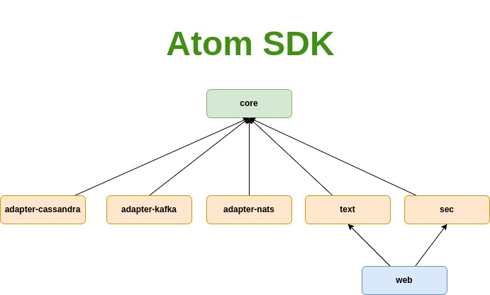

# java-kit

> [!WARNING]
> This repo is under construction and major refactoring at the moment

[](https://github.com/ismailmarmoush/java-kit/actions?query=workflow%3ARelease)
[](https://central.sonatype.com/artifact/com.marmoush.java-kit/core)
[](https://central.sonatype.com/artifact/com.marmoush.java-kit/core)
[](https://www.apache.org/licenses/LICENSE-2.0)

[](https://sonarcloud.io/summary/new_code?id=ismailmarmoush_java-kit)
[](https://sonarcloud.io/summary/new_code?id=ismailmarmoush_java-kit)
[](https://sonarcloud.io/summary/new_code?id=ismailmarmoush_java-kit)
[](https://sonarcloud.io/summary/new_code?id=ismailmarmoush_java-kit)
[](https://sonarcloud.io/summary/new_code?id=ismailmarmoush_java-kit)
[](https://sonarcloud.io/summary/new_code?id=ismailmarmoush_java-kit)
[](https://sonarcloud.io/summary/new_code?id=ismailmarmoush_java-kit)
[](https://sonarcloud.io/summary/new_code?id=ismailmarmoush_java-kit)
[](https://sonarcloud.io/summary/new_code?id=ismailmarmoush_java-kit)
[](https://sonarcloud.io/summary/new_code?id=ismailmarmoush_java-kit)
[](https://sonarcloud.io/summary/new_code?id=ismailmarmoush_java-kit)

> هذا العلم والعمل وقف للّه تعالي اسأل اللّه ان يرزقنا الاخلاص فالقول والعمل
>
> This work and knowledge is for the sake of Allah, may Allah grant us sincerity in what we say or do.

## Introduction

**Disclaimer:**
> `atom` is a work in progress utilities not meant for production usage yet, it's a pragmatic learning effort,
> please feel free to create issues or PRs.

Atom is an SDK to accelerate development, and it's a constant learning effort.

The currently used JDK is `24` and the motivation is to use the latest available JDK.

## Architecture

* [Documentation directory](/.docs)



* The `core` module
    * The `core` module consists of and intended to only contain **POJO** utilities, and standard interfaces which are
      implemented by child modules
    * Some utilities like for configuration management like `ConfigFileOps`, and `ResourceFileOps` (similar to Typesafe
      HOCOON
      library)
* `sec` module
    * `sec` for security utilities, e.g encryption, hashing, json web tokens etc. You can check the pom for more details
      on the libraries it depends on.
* `text` module
    * The `text` module is utilities and standardization of text serialization/deserialization, it relies on jackson
      libraries.

## User Guide

First make sure you can fetch repositories under from github

* TODO publishing maven central

```xml

<repositories>
    <repository>
        <id>github</id>
        <url>https://maven.pkg.github.com/ismailmarmoush/java-kit</url>
    </repository>
</repositories>
```

Then import in your pom dependencies

```xml

<dependency>
    <groupId>com.marmoush</groupId>
    <artifactId>java-kit</artifactId>
    <version>26.0.0</version>
</dependency>
```

### Versioning

The versioning is similar to semantic but with a shift where the first segment being the jdk version.

Format Example: `JDK_Version.major.mino`

## Developer Guide

* [x] Increase test coverage to >85%
* [ ] Publish to maven instead of Github
* [ ] Event-sourcing refactoring
* [ ] Performance and benchmarks project "atom-performance"
* [ ] JVM Profiling
* [ ] More structured releasing once library is stable

### Release notes

* `24.4.0`
    * Modular library Using Modules (module-info.java)
    * Handle non-modular dependencies
* `24.3.0`
    * Removed web module
* `24.0.0`
    * JDK upgrade
    * Rebase on latest JBOM
* `22.0.0`
    * Sync Aggregates
    * Merging with Active/Reactive libs
    * Removing Unnecessary modules (etcd)
* `21.20.0`
    * Removed reliance on vavr
* `21.1.0`
    * Moving Event-sourcing and testsuite modules to reactive
